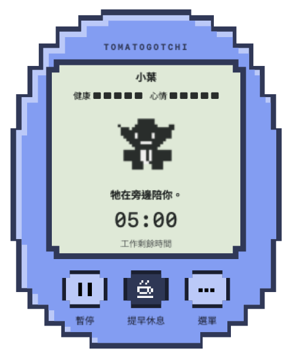
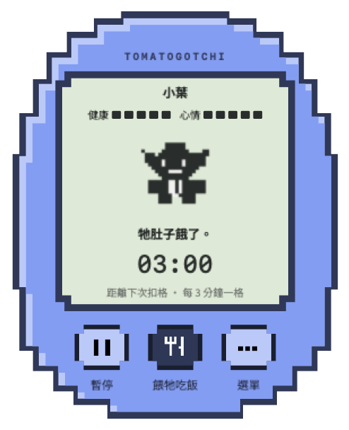
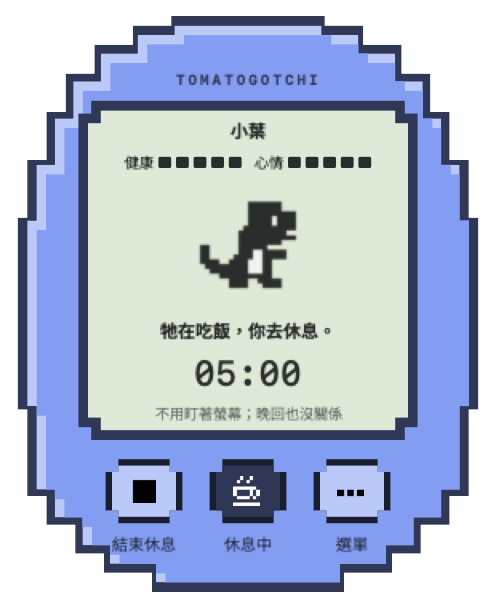

# Tomatogotchi

[繁體中文](README.md) · [English](README.en.md) · [日本語](README.ja.md)

A pixel pet living in a corner of your Mac desktop. Build a routine of focused work, care, and rest together. No account or AI API is required.

## Preview

| Work timer | Time for care | Taking a break |
| :---: | :---: | :---: |
|  |  |  |

Actual UI rendered for QA with isolated test data. The interface shown is in Traditional Chinese. Timer values are examples; work and break durations are adjustable.


## Official source and safety

- Official source: [chayawang/Tomatogotchi](https://github.com/chayawang/Tomatogotchi)
- **The only official App download channel: [GitHub Releases](https://github.com/chayawang/Tomatogotchi/releases)**
- Check the publisher, filename, version, and official SHA-256. Matching names or icons do not establish provenance.
- Forks and third-party modifications are not endorsed. Source code and original assets use [BSD-3-Clause](LICENSE), which permits modification, redistribution, and commercial use subject to its conditions. Preserve the license and disclaimer; the copyright holder's or contributors' names may not be used to endorse derived products without permission.

[Official source and disclaimer](DISCLAIMER.en.md) · [Security policy](SECURITY.en.md) · [Third-party notices](THIRD_PARTY_NOTICES.en.md)

## Current version

**1.0.3 build38, public prerelease**. The download supports Apple Silicon (arm64) only. The declared minimum is macOS 13; the physical test baseline is Apple Silicon with macOS 14.4.1. Intel and the minimum OS have not been physically tested. The App has an ad-hoc development signature, **no Developer ID signature and no Apple notarization**. Downloaded installation through Finder/Gatekeeper and some native interactions still need manual verification. Automated rendering and process checks do not establish full physical-device coverage.

- v1.0.3 adds selectable completion reminders, hatching on the first care response, next-round duration settings during rest, and matching adoption colors.

- Customize work and rest durations for each round, with suggested shortcuts.
- Idle, sleep, play, and short walks during work; actual walks can roam the current display's desktop and return when time expires.
- An unknown egg can hatch into a cat, dinosaur, dog, daruma, or goblin. Existing pets keep their species.
- Tombstone records preserve deceased pets' names, first meeting times, and death times after saying goodbye.

## Getting started

Read the [installation and user guide](docs/user-guide.en.md) and [release limitations](docs/releases/v1.0.3.en.md). Use `shasum -a 256 "path/to/downloaded-file"` to compare a download with the official Release's SHA256SUMS.txt. Obtain the reference from this repository; a checksum supplied by a third party does not establish the official source.

## Build from source

Requires macOS, Apple Command Line Tools (`xcode-select --install`), and Swift 5.9 or a compatible toolchain.

```sh
bash scripts/build-app.sh
```

### XCTest / PlatformPath warnings during a build

Some environments using only Command Line Tools report `could not determine XCTest paths` or `unable to lookup item 'PlatformPath'`. The [SwiftPM upstream report](https://github.com/swiftlang/swift-package-manager/issues/7480) describes both warnings and failed builds, depending on the tools in use.

Confirm that this invocation finishes successfully (exit code 0) and ends with `Built: .../build/Tomatogotchi.app`. `Generated editable pixel egg...` only confirms icon generation. The warning alone, or an App left by an earlier build, does not establish success.

If the build stops, update Command Line Tools to a version compatible with your macOS and retry. Inspect the selected tools with `xcode-select -p` and `swift --version`. If full Xcode is already installed, follow [Apple's tool selection instructions](https://developer.apple.com/documentation/xcode/configuring-command-line-tools-settings): select the installed Xcode version under **Xcode → Settings → Locations → Command Line Tools**, then rerun the build. This is a troubleshooting option, not a guaranteed fix for every error. If it still fails, report your macOS/Swift versions and the full error, removing private information such as personal paths first.

Downloading and using the App from [official Releases](https://github.com/chayawang/Tomatogotchi/releases) does not require Xcode or Command Line Tools.

The App is created at `build/Tomatogotchi.app`. Run the complete automated checks with:

```sh
bash scripts/verify.sh
```

Tests use separate temporary data. For manual testing, `python3 scripts/prepare-native-qa.py` creates a QA App bound to a separate data directory; open the path it prints. Do not test against your real pet data. Verification does not change system security permissions.

The repository contains no existing user or QA pet saves. Editable pixel assets are in `design/`, with generators in `scripts/make-*.py`. Fonts have a separate OFL license.
